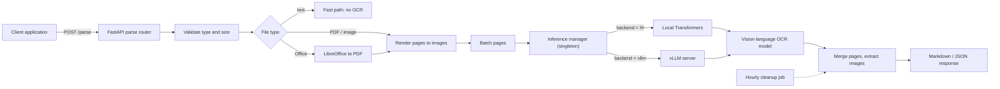

# DocIntel: Document Intelligence API

A GPU-backed microservice that turns PDFs, scanned images and Office documents into clean, structured Markdown or JSON, using a self-hosted vision-language OCR model served with vLLM.

> **Note:** The source code is private. This repository documents the architecture, design decisions and measured results. I'm happy to walk through the implementation in an interview.

---

## Overview

Every LLM application that works with documents (search, RAG, summarisation, question answering) depends on the first step: getting clean, layout-aware text out of messy files. Traditional OCR loses tables, headings and reading order, especially in scanned or multilingual documents.

DocIntel puts a ~5B-parameter vision-language OCR model behind a single `POST /parse` endpoint. It accepts PDFs, images and Office files, handles 90+ languages, and returns Markdown or JSON that downstream applications can use directly. The inference backend (local Hugging Face Transformers or a separate vLLM server) is selected with one configuration flag, so the same service runs on a laptop for development and on a GPU server in production.

## Key Features

- **One endpoint, many formats:** PDF, PNG, JPG, WEBP, TIFF, BMP, GIF, plus PPTX/PPT/DOCX/DOC (converted with headless LibreOffice) and plain text (fast path that skips OCR entirely).
- **90+ languages**, selected per request with BCP-47 language codes.
- **Swappable inference backend:** local Transformers or an OpenAI-compatible vLLM server, chosen by config with no code changes.
- **Image extraction:** figures embedded in documents are cropped, saved and linked back into the returned Markdown, with automatic hourly cleanup.
- **Production-ready service:** async FastAPI with the blocking GPU call offloaded to a worker thread, a structured error taxonomy mapped to HTTP codes, Swagger/ReDoc docs and a health endpoint.
- **Containerised GPU deployment:** Docker Compose with NVIDIA GPU passthrough, health checks, a persistent model cache and a warm-up request on start.

## Screenshots

| | |
|---|---|
|  |  |
| *Interactive API documentation* | *Upload a document, get structured Markdown* |
|  |  |
| *`POST /parse` request and JSON response* | *GPU utilisation during a parse request* |

## Architecture

## How It Works

1. A client uploads a document to `POST /parse` and chooses Markdown or JSON output.
2. The service validates the file, then dispatches by type: plain text returns immediately, Office files are converted to PDF, and PDFs and images are rendered page by page.
3. Pages are batched and sent to a single shared inference manager, so the model is loaded once and reused across requests.
4. The manager calls either the local Transformers backend or the vLLM server, depending on configuration.
5. Per-page results are merged, embedded images are saved and their links rewritten, and the response is returned.
6. A background task deletes expired upload folders every hour.

## Results

Benchmarked on a 10-page, 5.4 MB PDF on the same GPU server:

| Configuration | Time per document | Throughput |
|---|---|---|
| Transformers, batch size 1 | 3 min 50 s | 0.04 pages/s |
| Transformers, batch size 4 | 1 min 35 s | 0.11 pages/s |
| vLLM, cold start | 1 min 54 s | 0.09 pages/s |
| **vLLM, warm (prefix caching, continuous batching)** | **13.3 s** | **0.75 pages/s** |

- **7x faster** than the best Transformers configuration, and 17x faster than the initial batch-1 baseline.
- **Shared-GPU deployment:** VRAM was budgeted so that the OCR model runs alongside a separate large LLM on a single GPU.
- **Tested:** an automated pytest suite covers health checks, format and size validation, and both success and failure paths.

## Tech Stack

| Category | Tools |
|---|---|
| API | FastAPI, Uvicorn, Pydantic, pydantic-settings |
| Model | Vision-language OCR model (~5B parameters) via Hugging Face Transformers, PyTorch |
| Serving | vLLM (OpenAI-compatible server, prefix caching, bfloat16) |
| Document handling | LibreOffice (headless), PDF and image rendering |
| Deployment | Docker, Docker Compose, NVIDIA Container Toolkit |
| Testing | pytest |

## Engineering Decisions

- **Why vLLM:** Transformers processes requests one batch at a time and can't share the KV cache between requests. vLLM's continuous batching and prefix caching made it the clear winner once the model was warm, so it became the production backend. Transformers is kept for development and as a fallback.
- **Why a singleton model manager:** loading a ~5B model takes far longer than a parse request. One shared manager keeps the model in GPU memory, and `asyncio.to_thread()` keeps the API responsive while inference runs.
- **Why convert Office files to PDF first:** it gives every input format one rendering path, so layout handling and testing only have to be done once.

## My Role

I designed and built the service end to end: the FastAPI architecture, the dual-backend inference abstraction, the document dispatch pipeline, image extraction and cleanup, the Docker/GPU deployment, and the benchmarking behind the numbers above.

## Contact

**Zayed Makandar** | [zayedmakandar03@gmail.com](mailto:zayedmakandar03@gmail.com) | [LinkedIn](https://linkedin.com/in/your-handle)
