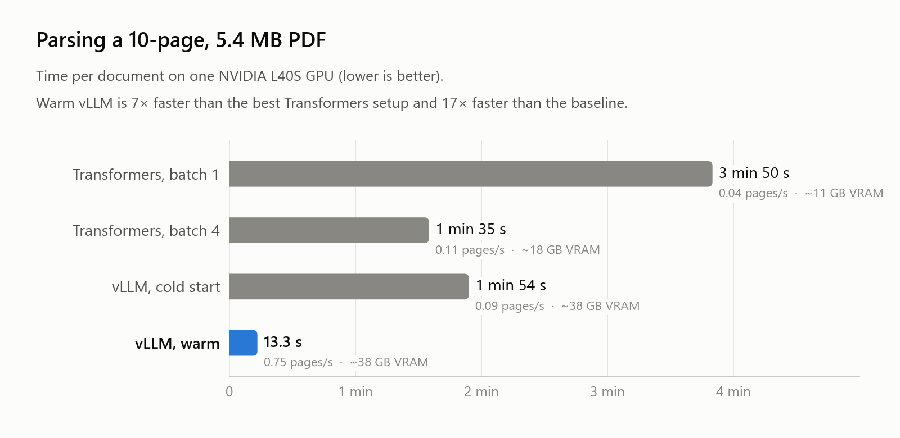
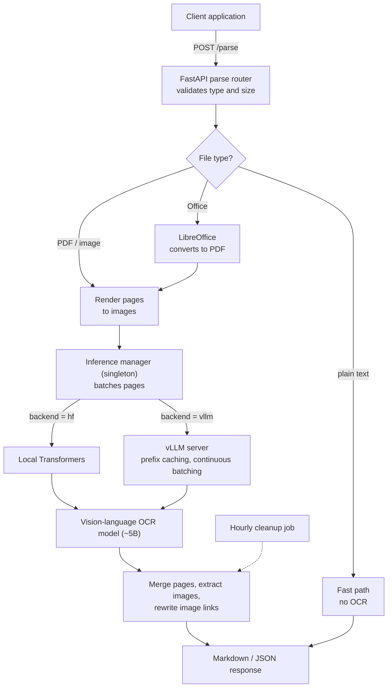
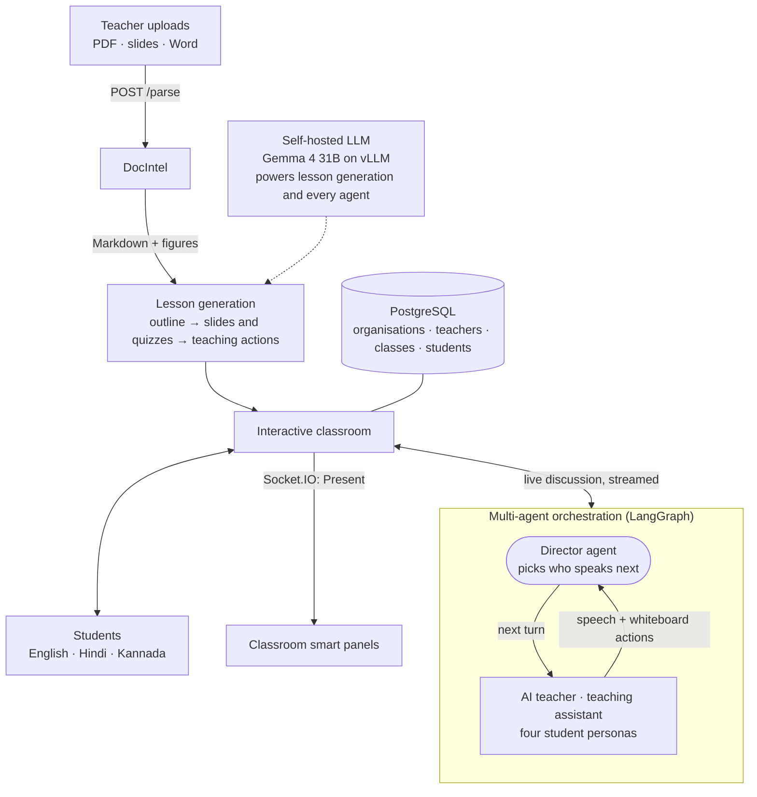

# DocIntel: Document Intelligence API

A GPU-backed microservice that turns PDFs, scanned images and Office documents into clean, structured Markdown or JSON, using a self-hosted vision-language OCR model served with vLLM. It is the document layer of a multi-agent AI classroom, where uploaded course material becomes an interactive, AI-taught lesson.

> **Note:** The source code is private. This repository documents the architecture, design decisions and measured results. I'm happy to walk through the implementation in an interview.

<picture>
  <source media="(prefers-color-scheme: dark)" srcset="assets/benchmark-dark.png">
  
</picture>

---

## Overview

Every LLM application that works with documents (search, RAG, summarisation, question answering) depends on the first step: getting clean, layout-aware text out of messy files. Traditional OCR loses tables, headings and reading order, especially in scanned or multilingual documents.

DocIntel puts a ~5B-parameter vision-language OCR model behind a single `POST /parse` endpoint. It accepts PDFs, images and Office files, handles 90+ languages, and returns Markdown or JSON that downstream applications can use directly. The inference backend (local Hugging Face Transformers or a separate vLLM server) is selected with one configuration flag, so the same service runs on a laptop for development and on a GPU server in production.

DocIntel is the document layer of a multi-agent learning platform. A teacher uploads course material, DocIntel converts it to Markdown, and a team of AI agents (a teacher, a teaching assistant and student personas, coordinated by a director agent) turns it into an interactive lesson in English, Hindi or Kannada.

## Key Features

- **One endpoint, many formats:** PDF, PNG, JPG, WEBP, TIFF, BMP, GIF, plus PPTX/PPT/DOCX/DOC (converted with headless LibreOffice) and plain text (fast path that skips OCR entirely).
- **90+ languages**, selected per request with BCP-47 language codes.
- **Swappable inference backend:** local Transformers or an OpenAI-compatible vLLM server, chosen by config with no code changes.
- **Image extraction:** figures embedded in documents are cropped, saved and linked back into the returned Markdown, with automatic hourly cleanup.
- **Production-ready service:** async FastAPI with the blocking GPU call offloaded to a worker thread, a structured error taxonomy mapped to HTTP codes, Swagger/ReDoc docs and a health endpoint.
- **Containerised GPU deployment:** Docker Compose with NVIDIA GPU passthrough, health checks, a persistent model cache and a warm-up request on start.

## Architecture

## Multi-Agent Learning Platform

DocIntel is the document layer of a larger multi-agent learning platform for multilingual classrooms.

### How the agents work together

- A **director agent**, built as a LangGraph state graph, decides who speaks next: the AI teacher, the teaching assistant or one of four student personas (a curious student, a note taker, a deep thinker and a class clown).
- Each agent's turn streams back to the classroom as speech plus whiteboard and slide actions. The director then picks the next speaker, until the discussion wraps up or a turn limit is reached.
- With a single agent, the director dispatches in plain code with no LLM call. With several agents, an LLM decides the turn order.

### What I built on the platform

- **Document ingestion:** integrated DocIntel as the platform's parser, so uploaded PDFs, slides and Word files become the source material for lesson generation.
- **Self-hosted LLM:** added a provider for Gemma 4 31B served with vLLM through an OpenAI-compatible API, so lesson generation and the agents can run entirely on local GPUs, with clear errors when a prompt overflows the model's context window.
- **Multilingual classrooms:** Hindi and Kannada across the interface and the agents' prompts, plus per-agent text-to-speech model selection.
- **School management:** a multi-tenant layer on PostgreSQL (12 SQL migrations) with role-based dashboards for platform admins, organisations, teachers and students, covering classes, batches and classroom devices.
- **Live presentation:** a Socket.IO channel lets a teacher press *Present* and open the lesson on every smart panel in the class at once.

## How It Works

1. A client uploads a document to `POST /parse` and chooses Markdown or JSON output.
2. The service validates the file, then dispatches by type: plain text returns immediately, Office files are converted to PDF, and PDFs and images are rendered page by page.
3. Pages are batched and sent to a single shared inference manager, so the model is loaded once and reused across requests.
4. The manager calls either the local Transformers backend or the vLLM server, depending on configuration.
5. Per-page results are merged, embedded images are saved and their links rewritten, and the response is returned.
6. A background task deletes expired upload folders every hour.

## Results

Benchmarked on a 10-page, 5.4 MB PDF on one NVIDIA L40S GPU:

| Configuration | Time per document | Throughput | GPU memory |
|---|---|---|---|
| Transformers, batch size 1 | 3 min 50 s | 0.04 pages/s | ~11 GB |
| Transformers, batch size 4 | 1 min 35 s | 0.11 pages/s | ~18 GB |
| vLLM, cold start | 1 min 54 s | 0.09 pages/s | ~38 GB |
| **vLLM, warm (prefix caching, continuous batching)** | **13.3 s** | **0.75 pages/s** | ~38 GB |

- **7× faster** than the best Transformers configuration, and **17× faster** than the initial batch-1 baseline.
- **Shared-GPU budgeting:** sized vLLM's memory share (22% of an 80 GB GPU, about 17.6 GB) so DocIntel can run beside a 31B-parameter LLM (about 62 GB) on a single GPU.
- **Tested:** an automated pytest suite covers health checks, format and size validation, and both success and failure paths.

## Tech Stack

| Category | Tools |
|---|---|
| API | FastAPI, Uvicorn, Pydantic, pydantic-settings |
| Model | Vision-language OCR model (~5B parameters) via Hugging Face Transformers, PyTorch |
| Serving | vLLM (OpenAI-compatible server, prefix caching, bfloat16) |
| Document handling | LibreOffice (headless), PDF and image rendering |
| Deployment | Docker, Docker Compose, NVIDIA Container Toolkit |
| Testing | pytest |
| Learning platform | Next.js, TypeScript, LangGraph, PostgreSQL, Socket.IO |
| Platform LLM | Gemma 4 31B, self-hosted with vLLM |

## Engineering Decisions

- **Why vLLM:** Transformers processes requests one batch at a time and can't share the KV cache between requests. vLLM's continuous batching and prefix caching made it the clear winner once the model was warm, so it became the production backend. Transformers is kept for development and as a fallback.
- **Why a singleton model manager:** loading a ~5B model takes far longer than a parse request. One shared manager keeps the model in GPU memory, and `asyncio.to_thread()` keeps the API responsive while inference runs.
- **Why convert Office files to PDF first:** it gives every input format one rendering path, so layout handling and testing only have to be done once.
- **Why a separate document service:** the learning platform stays a lightweight web app, while the GPU-heavy OCR model runs in its own container with its own share of GPU memory.

## My Role

I designed and built DocIntel end to end: the FastAPI architecture, the dual-backend inference abstraction, the document dispatch pipeline, image extraction and cleanup, the Docker/GPU deployment, and the benchmarking behind the numbers above. On the learning platform, I integrated DocIntel, added the self-hosted LLM provider, and built the Hindi and Kannada support, the multi-tenant school-management layer and live smart-panel presentation.

## Contact

**Zayed Makandar** | [zayedmakandar03@gmail.com](mailto:zayedmakandar03@gmail.com) | [LinkedIn](https://www.linkedin.com/in/zayed-makandar-642536422/) | [Portfolio](https://zayedmakandar.com)
